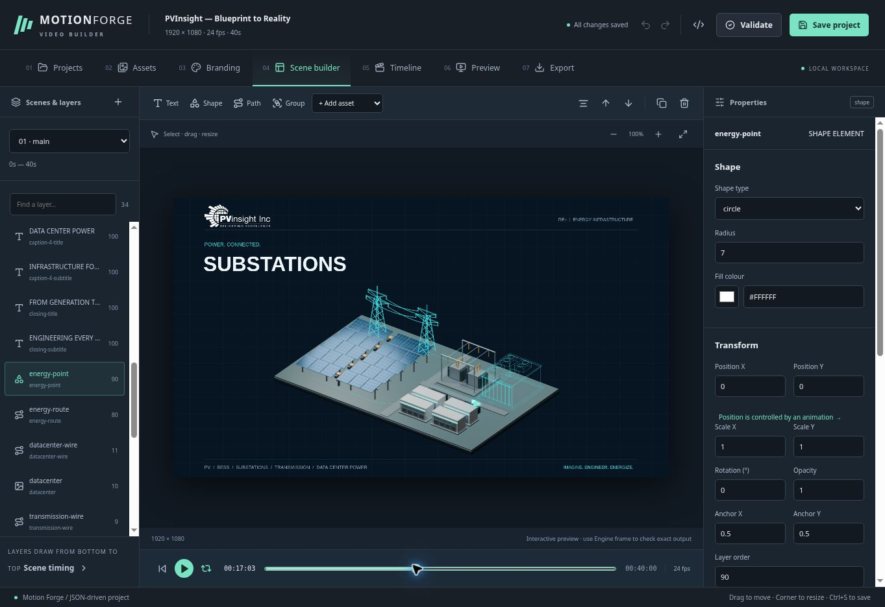

# Motion Forge

A modular, JSON-driven video maker. Define assets, scenes, branding and animation tracks, then validate, preview or export through the CLI, Python API or local HTTP API.

## Windows quick start

1. Install Python 3.11 or newer and extract/clone this repository.
2. Double-click `setup.bat`. It creates `.venv`, installs the package and API dependencies, and checks fonts and FFmpeg.
3. Double-click `start.bat` to open the video builder at `http://127.0.0.1:8765`.
4. Open a project or create one from a template. Edit, save, and export from the tabs.

Node.js is **not required to run the application**. The compiled UI is included. `render.bat` still renders the four-second generic example without opening the UI.

For the PVInsight example, open Terminal in the repository directory:

```powershell
render.bat projects\pvinsight-blueprint\project.json
```

The examples write to `output/quick-start/` and `output/pvinsight-blueprint/`. The repository includes all required example PNGs. Blender is optional and is used only to regenerate the 3D assets.

FFmpeg is resolved from `MOTION_FORGE_FFMPEG`, your PATH, or the platform binary supplied by `imageio-ffmpeg`. Normal installation does not require manual FFmpeg PATH edits. System fonts are resolved on Windows, Linux and macOS; you can instead register a font file for consistent typography across computers.

## Manual installation and CLI

```bash
python -m venv .venv
# Windows: .venv\Scripts\activate
# Linux/macOS: source .venv/bin/activate
python -m pip install -e ".[api,dev]"
motion-forge doctor
motion-forge ui --root .
motion-forge validate projects/quick-start/project.json
motion-forge preview projects/quick-start/project.json --time 2
motion-forge render projects/quick-start/project.json
motion-forge render projects/pvinsight-blueprint/project.json
```

Every CLI command also works as `python -m motion_forge ...`. Failed validation exits with status 1 and identifies the offending file/field. An unsuccessful export preserves an existing completed video.

## Video builder



| Tab | What you can do |
| --- | --- |
| Projects | Create blank projects, copy templates, and set canvas, FPS, and duration |
| Assets | Import transparent PNGs, fonts, path JSON, audio, and video; inspect usage |
| Branding | Set a logo, palette, and reusable text styles |
| Scene builder | Add elements, drag/resize, arrange layers, edit properties and effects |
| Timeline | Schedule animations, edit keyframes, drag track timing, edit routes and audio |
| Preview | Play a fast visual preview or render an exact engine PNG |
| Export | Set resolution/quality/audio, render MP4, monitor progress, watch and download |

Undo/redo and Ctrl+S are available. Advanced JSON changes are validated before applying. Save validates the whole project, backs up previous JSON in `cache/builder/backups/`, and rejects changes if the project was edited externally. Templates are copied into `projects/` before editing. Assets import immediately to the project folder; Save persists their registration. Removing an asset from the UI leaves its file intact.

Rendering runs one job at a time, stores results in `output/jobs/<job-id>/`, and continues while you change tabs. Keep the local server running until exports complete. The interactive canvas approximates text/effects for responsiveness; Engine frame and MP4 export use the original renderer. Fast playback is visual only; audio is included in exported videos when enabled.

See [builder architecture and API](docs/builder.md) for development details.

## JSON files

| File | Responsibility |
| --- | --- |
| `project.json` | Schema version, canvas, duration/FPS and configuration references |
| `assets.json` | Image, path, font, audio and video IDs and paths |
| `branding.json` | Palette, logo ID and reusable text styles |
| `scenes/*.json` | Elements, groups, layers, layout, visibility and effects |
| `timeline.json` | Scene clips, shared paths, keyframes, animation tracks and audio |
| `export.json` | Filename, directory, resolution, H.264 quality, audio and loop check |

All configuration and asset paths resolve relative to the entry `project.json`. There are no PVInsight-specific branches in the engine. Start another video by copying `templates/basic-motion/` and editing its JSON files.

## Reusable templates

- [Basic motion](templates/basic-motion/): a short generic starting point.
- [PVInsight Blueprint to Reality](templates/pvinsight-blueprint/): the complete PVI video, including JSON configuration, transparent vertical PNGs, blueprint geometry and logos.

Copy an entire template into `projects/<your-project>` to customize it, or run the PVI template directly:

```powershell
.\render.bat templates\pvinsight-blueprint\project.json
```

The PVI template exports to `output/pvinsight-blueprint-template/`, separately from the original example. See the [template guide](templates/README.md).

## Supported in 0.2

- Image, text, shape, path, group and video elements.
- Position, scale, clockwise rotation, opacity, fill/stroke, stroke width, reveal, text reveal and effect-property tracks.
- `fadeIn`, `fadeOut`, `slideIn`, `zoomIn`, `pulse`, `followPath`, `wipeReveal` and `typewriter` presets.
- Glow, shadow, blur and time-sampled trails; polyline and cubic Bezier paths.
- One project clock, constant arc-length traversal, deterministic preview seeking, explicit repeats and conflict detection.
- Multiple audio tracks with trim, volume, fade-in/out and delayed starts. Video elements are silent; schedule their audio explicitly.
- PNG previews, H.264 MP4 exports, FFmpeg error logs and JSON render manifests. Optional loop endpoint comparison reports a warning rather than modifying the animation.
- A local API with one render worker, persisted job status and progress.
- Installed Python plugin registries for animations, effects and element renderers.

The single-user builder edits the same JSON files used by the CLI and API. Built-in easing is linear/ease-in/ease-out/ease-in-out; video playback speed must be positive. Keyframe timing is project-global. Bezier length is approximated by sampled segments. The Blender helper remains a project-specific optional generator, separate from the core.

## Python API

```python
from motion_forge import load_project, preview_project, render_project

project = load_project("projects/quick-start/project.json")
preview_project("projects/quick-start/project.json", time=2)
render_project("projects/quick-start/project.json")
```

## HTTP API

```bash
motion-forge serve --root . --host 127.0.0.1 --port 8765
```

Open `http://127.0.0.1:8765/docs` for the interactive API. Submit `{"project":"projects/quick-start/project.json"}` to `POST /validate` or `POST /renders`; poll `GET /jobs/{id}` and download `GET /jobs/{id}/video`. Project and asset references are confined to the configured API root. Jobs interrupted by a server restart become failed and can be resubmitted.

## Development

```bash
python -m unittest discover -s tests -v
cd ui
npm ci
npm test
npm run build
```

Node.js 22+ is needed only when developing the UI. After building, restart the Python server to serve the latest compiled files. Commit `app/motion_forge/web/dist/` with UI changes so normal users can run with Python alone. For live UI development, run the Python API on port 8765 and `npm run dev` in `ui/` on port 5173.

CI runs the suite on Windows and Linux with Python 3.11 and 3.12. See [architecture](docs/architecture.md), [JSON reference](docs/json-reference.md), [animations and effects](docs/animations-and-effects.md), [plugins](docs/creating-plugins.md), and [API reference](docs/api-reference.md).
